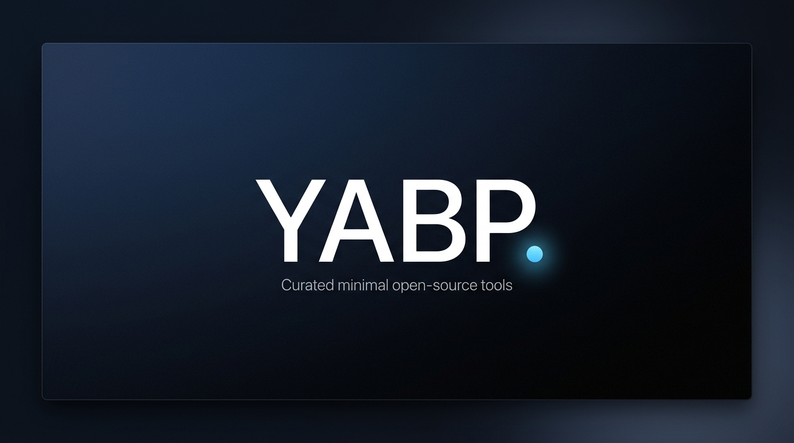

# YABP: Yet Another Boring Project

<p align="center">
  
</p>

Curated ecosystem of minimalist, highly reliable, and distraction-free open-source developer tools.

[](https://yabp.netlify.app)
[](https://app.netlify.com/sites/yabp/deploys)

---

## About the Initiative

YABP provides developers of minimal, high-utility projects with a professional community brand. It acts as an umbrella namespace to showcase clean software tools built with Apple-style design aesthetics and strict privacy standards.

### Existing Showcase Projects

The initiative hosts several popular open-source projects:
*   **Thoughts**: A distraction-free micro-journaling diary.
*   **NoteKar**: A lightweight note log tool to record events and dates.
*   **Empty**: A plugin-first system where nothing exists by default.
*   **OriginJS**: Zero-config metadata utility for client visibility.

Live Showcase Platform: [yabp.netlify.app](https://yabp.netlify.app)

---

## Structure

*   [index.html](file:///d:/Github_Projects/Yet-Another-Boring-Project/index.html): Showcase landing portal.
*   [style.css](file:///d:/Github_Projects/Yet-Another-Boring-Project/style.css): Global layout and design system.
*   [app.js](file:///d:/Github_Projects/Yet-Another-Boring-Project/app.js): Application logic and dynamic queries.
*   [projects.json](file:///d:/Github_Projects/Yet-Another-Boring-Project/projects.json): Official project register.
*   [LICENSE](file:///d:/Github_Projects/Yet-Another-Boring-Project/LICENSE): Open-source terms.

---

## Submit Your Project

We welcome contributions of functional, aesthetic utility tools:
1.  Fork this repository.
2.  Add your project object to the `projects` array in [projects.json](file:///d:/Github_Projects/Yet-Another-Boring-Project/projects.json):
    ```json
    {
      "name": "Your Project Name",
      "date": "2026-07-30",
      "description": "A single sentence explaining the utility value of your project.",
      "link": "https://your-live-link.com",
      "github": "https://github.com/username/repo"
    }
    ```
3.  Include the YABP Logo Badge in your project README (see badge instructions below).
4.  Open a Pull Request. CI validation will check your JSON formatting automatically.
5.  **Review & Manual Verification:** YABP is in its initial stage. Submissions take longer to appear because each project is personally tested and manually verified. Only the best projects are kept, and any project may be removed without prior notice to preserve curation quality.

Read the official [Contributing Guidelines](https://yabp.netlify.app/contributing.html) for full quality standards.

---

## 2-Way Trust Verification (Badge & Link Generator)

All directory projects must link back to YABP. By appending your project's URL, the YABP portal will dynamically verify your listing and display a verification trust modal.

You can instantly generate your custom badge links using the interactive **Badge & Link Generator** on the website: [yabp.netlify.app/contributing.html](https://yabp.netlify.app/contributing.html).

If you wish to copy them manually, replace `YOUR_PROJECT_URL` with your exact live project or GitHub URL (ensure this matches your `projects.json` entry):

### README HTML Badge (Mandatory for GitHub repositories)
```html
<a href="https://yabp.netlify.app/?verify=YOUR_PROJECT_URL">
  
</a>
```

### README Markdown Badge
```markdown
[](https://yabp.netlify.app/?verify=YOUR_PROJECT_URL)
```

### Direct Verification Link (Optional for App UI/Websites)
If you do not want the logo badge on your app UI, you can link directly to:
```
https://yabp.netlify.app/?verify=YOUR_PROJECT_URL
```

---

## Developer Policies & License

All participants and listed tools must agree to our community developer standards:
*   [Terms of Use](https://yabp.netlify.app/terms.html): Brand guidelines, curation criteria, and directory maintenance policies.
*   [Contributing Guidelines](https://yabp.netlify.app/contributing.html): JSON schema specifications, 2-way verification, and PR workflow.
*   [Security Policy](https://yabp.netlify.app/security.html): Vulnerability disclosure protocol and ecosystem protection.
*   [MIT License](https://yabp.netlify.app/license.html): Open-source license terms and permissions. Member projects retain their own licensing.
*   **Official Support**: [yabp.support@gmail.com](mailto:yabp.support@gmail.com)
